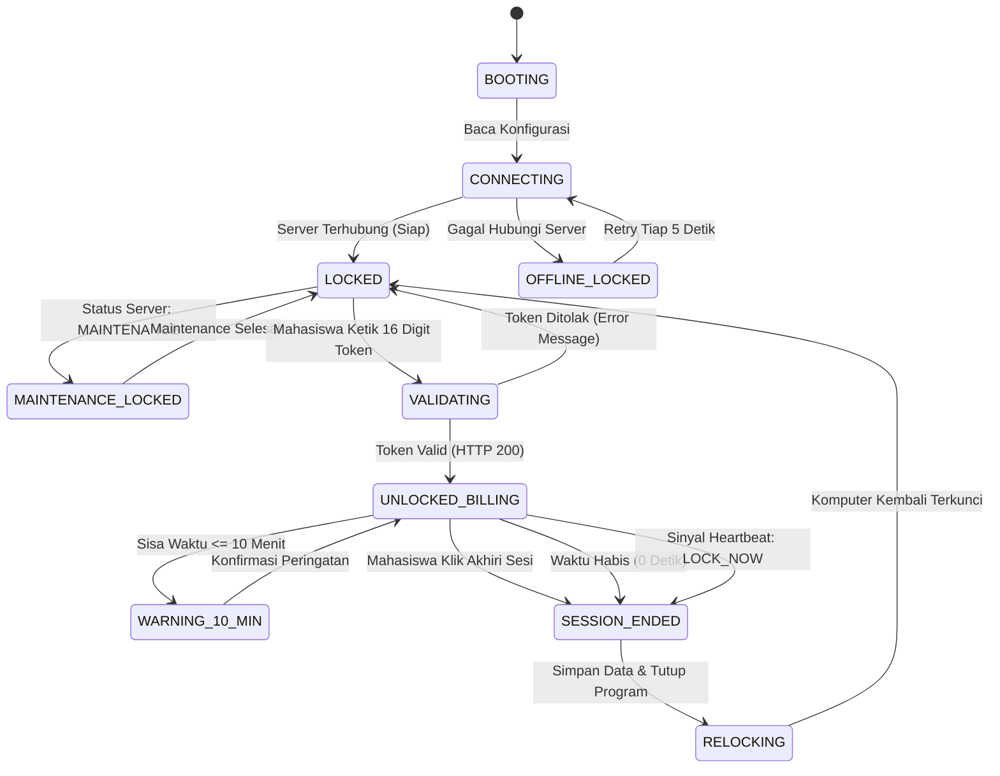

# Panduan & Catatan Teknis Pengembangan Aplikasi Desktop Agent (WARLAB Kiosk Client)

Dokumen ini merupakan spesifikasi teknis dan panduan arsitektur pengembangan **Aplikasi Desktop Client (Desktop Agent)** yang akan dipasang pada setiap unit komputer workstation di laboratorium (**PC-01 s/d PC-04**).

---

## 1. Ikhtisar & Peran Aplikasi Desktop

WARLAB Desktop Agent adalah aplikasi native Windows yang berjalan secara otomatis saat komputer workstation laboratorium dinyalakan (*auto-startup on boot*). Aplikasi ini memiliki dua fungsi utama:

1. **Layar Penguncian Workstation (*Kiosk Lock Screen*)**:
   * Mengunci tampilan antarmuka Windows sebelum mahasiswa melakukan login resmi.
   * Menyediakan formulir input **Token 16 Digit** (`XXXX-XXXX-XXXX-XXXX`) yang diperoleh mahasiswa dari web portal setelah reservasi disetujui oleh Kepala Lab.
   * Menampilkan informasi identitas unit PC, jam operasional, dan status pemeliharaan (*maintenance*).

2. **Pemantau Sesi & Billing Melayang (*Floating Billing Session Monitor*)**:
   * Membuka kunci desktop Windows seketika token valid terverifikasi.
   * Menampilkan widget timer mengambang (*always-on-top*) di pojok layar yang menghitung mundur sisa durasi pemakaian.
   * Mengirimkan denyut status (*heartbeat*) berkala ke server Laravel.
   * Mengunci kembali komputer secara otomatis saat durasi habis atau jika sesi dihentikan paksa (*Force End*) oleh Kepala Laboratorium.

---

## 2. Arsitektur & Pilihan Teknologi

### Rekomendasi Utama (Platform Paling Disarankan)
* **Bahasa & Framework**: **C# .NET 8 atau .NET 10 (WPF / Windows Presentation Foundation)**
* **Alasan Pemilihan**:
  * Native performa tinggi di ekosistem Windows 10/11 64-bit.
  * Dukungan penuh terhadap Win32 Low-Level Keyboard Hooks (`SetWindowsHookEx`) untuk memblokir tombol sistem (`WinKey`, `Alt+Tab`, `Alt+F4`, `Ctrl+Esc`).
  * Integrasi mudah dengan Windows Registry (menonaktifkan Task Manager / `DisableTaskMgr`).
  * Kemampuan membuat window fullscreen *Always-on-Top* tanpa border (*WindowStyle="None"*, *ResizeMode="NoResize"*).

### Pilihan Alternatif
* **Electron / Node.js**: Mempercepat pembuatan UI menggunakan HTML/Tailwind CSS, namun memerlukan native addon (C++) untuk keyboard hook tingkat rendah.
* **Python PyQt6 / PySide6**: Cepat untuk prototyping, menggunakan modul `keyboard` dan `ctypes` untuk interaksi API Windows.

---

## 3. Konfigurasi Lokal Komputer (`appsettings.json`)

Setiap PC workstation lab menyimpan berkas konfigurasi lokal sederhana pada direktori instalasi aplikasi (contoh: `C:\Program Files\WARLAB\appsettings.json`):

```json
{
  "Server": {
    "BaseUrl": "http://192.168.1.100:8000",
    "TimeoutSeconds": 10
  },
  "Workstation": {
    "ComputerCode": "PC-01",
    "ComputerName": "Workstation AI 01",
    "Location": "Lab Sains Data & AI, Lantai 3"
  },
  "Billing": {
    "HeartbeatIntervalSeconds": 15,
    "WarningRemainingMinutes": 10,
    "ForceLockOnNetworkFailureMinutes": 5
  }
}
```

> **Catatan Konfigurasi**: Hanya bagian `"ComputerCode"` yang dibedakan pada masing-masing PC (`PC-01`, `PC-02`, `PC-03`, `PC-04`).

---

## 4. Spesifikasi Kontrak REST API (Laravel Backend)

Server Laravel telah menyediakan 4 endpoint khusus di bawah grup `/api/desktop/*` (terdefinisi di [`routes/api.php`](file:///c:/laragon/www/lab-data-sains/routes/api.php) dan ditangani oleh [`DesktopAgentController.php`](file:///c:/laragon/www/lab-data-sains/app/Http/Controllers/Api/DesktopAgentController.php)):

### A. Cek Status Kesiapan Komputer
Digunakan saat aplikasi baru pertama kali dijalankan (*booting*) atau sedang standby di layar kunci.

* **Endpoint**: `GET /api/desktop/status/{computer_code}`
* **Contoh Request**: `GET http://192.168.1.100:8000/api/desktop/status/PC-01`
* **Headers**: `Accept: application/json`
* **Respon Sukses (PC Siap / Terkunci)**:
  ```json
  {
    "success": true,
    "computer_code": "PC-01",
    "computer_name": "Workstation AI 01",
    "status": "ONLINE_LOCKED",
    "can_login": true,
    "message": "Komputer siap menerima token akses check-in mahasiswa."
  }
  ```
* **Respon Jika Sedang Maintenance**:
  ```json
  {
    "success": true,
    "computer_code": "PC-01",
    "status": "MAINTENANCE",
    "can_login": false,
    "message": "Komputer sedang dalam masa pemeliharaan (maintenance).",
    "maintenance_until": "2026-11-03T10:00:00+07:00",
    "maintenance_reason": "Pembersihan thermal paste & update CUDA"
  }
  ```

---

### B. Validasi Token & Check-In Komputer
Dipanggil saat mahasiswa mengetikkan 16 digit token pada layar monitor PC.

* **Endpoint**: `POST /api/desktop/check-in`
* **Headers**: 
  * `Content-Type: application/json`
  * `Accept: application/json`
* **Request Body Payload**:
  ```json
  {
    "computer_code": "PC-01",
    "token": "7K9P-X4M2-9AB3-C8F1"
  }
  ```
  *(Catatan: Token dapat dikirim dalam format strip `XXXX-XXXX-XXXX-XXXX` maupun 16 karakter langsung `7K9PX4M29AB3C8F1`).*

* **Respon Sukses (HTTP 200 OK - Buka Layar)**:
  ```json
  {
    "success": true,
    "message": "Check-in berhasil! Layar unit PC-01 berhasil dibuka.",
    "session": {
      "session_id": 18,
      "student_name": "M. Subagja",
      "nim": "22081010045",
      "computer_code": "PC-01",
      "computer_name": "Workstation AI 01",
      "check_in_time": "09:05 WIB",
      "scheduled_end_time": "12:00 WIB",
      "duration_seconds": 10500,
      "scheduled_end_at": "2026-11-02T12:00:00+07:00"
    }
  }
  ```

* **Respon Gagal / Penolakan (HTTP 422 Unprocessable Content / HTTP 404)**:
  ```json
  {
    "success": false,
    "message": "Token ini diterbitkan khusus untuk unit PC-02. Anda tidak dapat menggunakannya di PC-01."
  }
  ```
  *Contoh pesan galat lainnya yang otomatis divalidasi server:*
  * *"Token akses tidak valid atau sudah pernah digunakan."*
  * *"Waktu peminjaman belum dimulai. Sesi Anda dijadwalkan mulai pukul 13:00 WIB."*
  * *"Waktu jadwal reservasi telah berakhir pada pukul 12:00 WIB."*
  * *"Komputer ini sedang dalam masa pemeliharaan teknis (maintenance)."*

---

### C. Denyut Status Berkala (*Heartbeat*)
Aplikasi desktop mengirimkan request ini setiap **15 detik** selama sesi berlangsung untuk memastikan sinkronisasi status dengan server.

* **Endpoint**: `POST /api/desktop/heartbeat`
* **Request Body Payload**:
  ```json
  {
    "computer_code": "PC-01",
    "session_id": 18
  }
  ```

* **Respon Sesi Masih Aktif**:
  ```json
  {
    "success": true,
    "status": "ACTIVE",
    "command": "KEEP_RUNNING",
    "remaining_seconds": 9600,
    "scheduled_end_at": "2026-11-02T12:00:00+07:00"
  }
  ```

* **Respon Sesi Diputus / Dihentikan Kepala Lab (*Force End*)**:
  ```json
  {
    "success": true,
    "status": "TERMINATED",
    "command": "LOCK_NOW",
    "message": "Sesi billing telah diakhiri (waktu habis atau Force End oleh Kepala Lab)."
  }
  ```
  *(Saat menerima `"command": "LOCK_NOW"`, aplikasi desktop wajib seketika mengunci kembali desktop Windows).*

---

### D. Logout / Pengakhiran Sesi dari Layar PC
Dipanggil saat mahasiswa mengklik tombol "Akhiri Sesi / Logout" pada floating timer widget di layar Windows.

* **Endpoint**: `POST /api/desktop/session/end`
* **Request Body Payload**:
  ```json
  {
    "computer_code": "PC-01",
    "session_id": 18
  }
  ```

* **Respon Sukses (HTTP 200 OK)**:
  ```json
  {
    "success": true,
    "message": "Sesi penggunaan workstation berhasil diselesaikan. Layar komputer dikunci kembali."
  }
  ```

---

## 5. Diagram State Machine & Siklus Hidup Client



---

## 6. Fitur Keamanan & Kiosk Lock Screen Hardening

Agar mahasiswa tidak dapat melewati (*bypass*) layar kunci saat komputer menyala, aplikasi desktop wajib menerapkan pengamanan berikut:

### A. Low-Level Keyboard Hook (Blokir Pintasan Tombol)
Gunakan API Windows `SetWindowsHookEx` dengan `WH_KEYBOARD_LL`:
* **Kombinasi yang Wajib Diblokir**:
  * Tombol Windows (`LWin`, `RWin`)
  * `Alt + Tab` (Pindah jendela)
  * `Alt + F4` (Tutup program)
  * `Ctrl + Esc` (Menu Start)
  * `Alt + Esc` (Ganti fokus)
  * `F11` (Full-screen toggle)

### B. Menonaktifkan Task Manager & Cad Lock
Pada Windows, kombinasi `Ctrl + Alt + Delete` ditangani langsung oleh kernel Windows (GINA/Winlogon) dan tidak dapat diblokir oleh hook biasa. Cara pencegahannya:
1. Saat aplikasi dalam status **LOCKED**, set nilai registry:
   `HKCU\Software\Microsoft\Windows\CurrentVersion\Policies\System` $\rightarrow$ `DisableTaskMgr = 1`
   `HKCU\Software\Microsoft\Windows\CurrentVersion\Policies\System` $\rightarrow$ `DisableLockWorkstation = 1`
2. Saat mahasiswa berhasil login (**UNLOCKED_BILLING**), kembalikan nilai menjadi `0` agar mahasiswa dapat menggunakan komputer secara wajar.
3. Saat sesi berakhir, kembalikan kembali ke `1`.

### C. Auto-Startup & Shell Replacement
* Tambahkan aplikasi ke **Windows Task Scheduler** dengan trigger: *At log on of any user* dan opsi *Run with highest privileges* (Administrator).
* Atau daftarkan pada Registry Run:
  `HKLM\SOFTWARE\Microsoft\Windows\CurrentVersion\Run` $\rightarrow$ `"WARLABAgent" = "C:\Program Files\WARLAB\WARLABAgent.exe"`

---

## 7. Spesifikasi Antarmuka Pengguna (UI/UX)

### Layar 1: Layar Kunci Kiosk (*Fullscreen Lock Screen*)
* **Warna & Gaya**: Dark Theme elegan bernuansa Laboratorium AI (latar `#0b1c30` dengan aksen indigo `#424dc4` dan kartu putih/abu-abu).
* **Komponen Tampilan**:
  1. **Header**: Logo Universitas / Prodi, Judul *"Laboratorium Sains Data & AI"*, Jam Digital besar (WIB), Tanggal hari ini.
  2. **Identitas Unit**: Badge besar monospace font bold: **`PC-01 (Workstation AI 01)`**.
  3. **Input Token 16 Digit**:
     * 4 kotak input terpisah (masing-masing 4 digit): `[ 7K9P ] - [ X4M2 ] - [ 9AB3 ] - [ C8F1 ]`.
     * Karakter otomatis menjadi huruf besar (*auto-uppercase*).
     * Fokus otomatis berpindah ke kotak berikutnya setelah 4 karakter terisi (*auto-advance*).
     * Tombol `Backspace` otomatis kembali ke kotak sebelumnya jika kotak saat ini kosong.
  4. **Tombol Masuk**: Tombol menonjol *"Buka Kunci Komputer"* berlatar `#424dc4` dengan efek hover dan animasi loading spinner saat request diproses.
  5. **Area Pesan Kesalahan**: Menampilkan alert merah ramah pengguna jika token salah, belum waktunya, atau kadaluwarsa.
  6. **Footer**: Informasi bantuan laboran dan jam operasional lab (07.00 – 16.00 WIB).

### Layar 2: Widget Billing Mengambang (*Floating Timer*)
* **Ukuran & Posisi**: Jendela kecil melayang (*width 260px, height 85px*) di pojok kanan atas desktop Windows.
* **Sifat Jendela**: *Topmost = true* (selalu di atas aplikasi lain), dapat digeser (*draggable*) oleh mahasiswa agar tidak menghalangi pekerjaan.
* **Komponen Tampilan**:
  1. Sisa waktu dalam format besar: **`02:45:10`** (Jam : Menit : Detik).
  2. Nama mahasiswa & NIM: `M. Subagja (22081010045)`.
  3. Status indikator warna:
     * Hijau: Sisa waktu $> 30$ menit.
     * Kuning/Amber: Sisa waktu antara $10$ s/d $30$ menit.
     * Merah berkedip: Sisa waktu $< 10$ menit (disertai bunyi pop-up peringatan agar mahasiswa menyimpan data).
  4. Tombol merah kecil: **"Akhiri Sesi"** (membuka modal konfirmasi: *"Apakah Anda yakin ingin logout? Data yang belum disimpan ke Google Drive / flashdisk dapat hilang setelah restart"*).

### Layar 3: Layar Mode Pemeliharaan (*Maintenance Mode Screen*)
* Ditampilkan otomatis jika server mengembalikan status `"MAINTENANCE"`.
* Input token disembunyikan/dinonaktifkan.
* Menampilkan badge oranye besar: **`⚠️ Unit Sedang Dalam Pemeliharaan Teknis`**.
* Keterangan alasan pemeliharaan dari Kepala Lab dan estimasi waktu selesai.

---

## 8. Contoh Implementasi Boilerplate C# WPF (`ApiService.cs`)

Berikut adalah contoh kelas C# untuk berkomunikasi dengan API Laravel:

```csharp
using System;
using System.Net.Http;
using System.Text;
using System.Text.Json;
using System.Threading.Tasks;

public class ApiService
{
    private readonly HttpClient _httpClient;
    private readonly string _baseUrl;

    public ApiService(string baseUrl)
    {
        _baseUrl = baseUrl.TrimEnd('/');
        _httpClient = new HttpClient { Timeout = TimeSpan.FromSeconds(10) };
        _httpClient.DefaultRequestHeaders.Add("Accept", "application/json");
    }

    public async Task<CheckInResult> SubmitTokenAsync(string computerCode, string token)
    {
        var payload = new { computer_code = computerCode, token = token };
        var jsonContent = new StringContent(JsonSerializer.Serialize(payload), Encoding.UTF8, "application/json");

        try
        {
            var response = await _httpClient.PostAsync($"{_baseUrl}/api/desktop/check-in", jsonContent);
            var responseBody = await response.Content.ReadAsStringAsync();

            using var doc = JsonDocument.Parse(responseBody);
            var root = doc.RootElement;
            bool success = root.GetProperty("success").GetBoolean();
            string message = root.GetProperty("message").GetString();

            if (response.IsSuccessStatusCode && success)
            {
                var session = root.GetProperty("session");
                return new CheckInResult
                {
                    IsSuccess = true,
                    Message = message,
                    SessionId = session.GetProperty("session_id").GetInt32(),
                    StudentName = session.GetProperty("student_name").GetString(),
                    Nim = session.GetProperty("nim").GetString(),
                    DurationSeconds = session.GetProperty("duration_seconds").GetInt32()
                };
            }

            return new CheckInResult { IsSuccess = false, Message = message };
        }
        catch (Exception ex)
        {
            return new CheckInResult { IsSuccess = false, Message = $"Koneksi ke server gagal: {ex.Message}" };
        }
    }

    public async Task<HeartbeatResult> SendHeartbeatAsync(string computerCode, int sessionId)
    {
        var payload = new { computer_code = computerCode, session_id = sessionId };
        var jsonContent = new StringContent(JsonSerializer.Serialize(payload), Encoding.UTF8, "application/json");

        try
        {
            var response = await _httpClient.PostAsync($"{_baseUrl}/api/desktop/heartbeat", jsonContent);
            var responseBody = await response.Content.ReadAsStringAsync();

            using var doc = JsonDocument.Parse(responseBody);
            var root = doc.RootElement;
            string command = root.GetProperty("command").GetString();
            int remainingSecs = root.TryGetProperty("remaining_seconds", out var secElem) ? secElem.GetInt32() : 0;

            return new HeartbeatResult
            {
                Command = command, // "KEEP_RUNNING" atau "LOCK_NOW"
                RemainingSeconds = remainingSecs
            };
        }
        catch
        {
            return new HeartbeatResult { Command = "KEEP_RUNNING", RemainingSeconds = -1 };
        }
    }
}

public class CheckInResult
{
    public bool IsSuccess { get; set; }
    public string Message { get; set; }
    public int SessionId { get; set; }
    public string StudentName { get; set; }
    public string Nim { get; set; }
    public int DurationSeconds { get; set; }
}

public class HeartbeatResult
{
    public string Command { get; set; }
    public int RemainingSeconds { get; set; }
}
```

---

## 9. Checklist Tahapan Implementasi Klien PC

| Langkah | Item Pekerjaan | Status |
| :---: | :--- | :---: |
| 1 | Pembuatan REST API Backend Laravel (`/api/desktop/*`) | **Selesai (Aktif)** |
| 2 | Generator Token 16 Digit Kriptografis (`XXXX-XXXX-XXXX-XXXX`) | **Selesai (Aktif)** |
| 3 | Penghapusan Tombol Check-in Web Mahasiswa | **Selesai (Aktif)** |
| 4 | Inisialisasi Project Visual Studio (C# .NET 8 WPF) | *Tahap Berikutnya* |
| 5 | Desain Fullscreen Kiosk Lock Screen XAML | *Tahap Berikutnya* |
| 6 | Pemasangan Win32 Low-Level Keyboard Hook | *Tahap Berikutnya* |
| 7 | Integrasi REST API Client (`ApiService.cs`) | *Tahap Berikutnya* |
| 8 | Desain Floating Timer Widget & Logout Modal | *Tahap Berikutnya* |
| 9 | Uji Coba Lapangan di PC-01 s/d PC-04 Lab | *Tahap Pengujian* |

