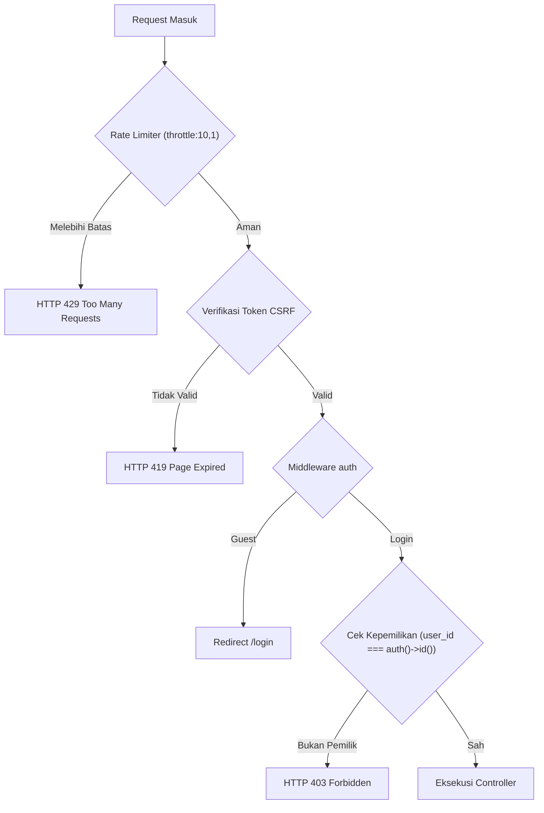

# Ringkasan Catatan Perubahan WARLAB (Frontend, Backend & Security)

Dokumen ini memuat rekapitulasi teknis seluruh pembaruan sistem yang telah diimplementasikan pada aplikasi **WARLAB (Warung Laboratorium - Reservasi & Billing Komputer Lab Sains Data & AI)**.

---

## 1. Frontend (UI/UX & Client-side)

### A. Transformasi Status Unit Komputer
* **Klasifikasi Status Baru**: Mengganti 4 status lama (*Tersedia*, *Sesi Anda*, *Digunakan*, *Terjadwal*) menjadi 4 level okupansi:
  * **KOSONG**: Unit belum memiliki booking/sesi hari ini.
  * **TERISI**: Terdapat reservasi/sesi $\le 3$ jam atau 1 sesi.
  * **PADAT**: Pemakaian $> 3$ jam atau $\ge 2$ sesi, namun masih ada slot kosong $\ge 30$ menit.
  * **PENUH**: Tidak ada slot kosong $\ge 30$ menit tersisa pada jam operasional.
* **Rentang Waktu Jam Kosong (Buffer 30 Menit)**: Menampilkan rentang waktu unit kosong secara real-time. Jika terdapat booking pukul 13.00, sistem menampilkan waktu kosong hingga 12.30 WIB (buffer 30 menit).
* **Legend Status**: Memperbarui indikator status di bagian atas tabel unit komputer lab pada dashboard.

### B. Halaman & Portal Buku Booking
* **Halaman Matriks Jadwal (`/buku-booking`)**:
  * Matriks interaktif 9 blok jam operasional (07.00 – 16.00 WIB) untuk 4 unit komputer (`PC-01` s/d `PC-04`).
  * Visualisasi blok jam terisi (lengkap dengan nama peminjam & peruntukan) serta blok jam kosong yang dapat diklik langsung untuk *quick reservation*.
  * Navigasi tanggal cepat (Hari Ini, Kemarin, Besok, dan Date Picker).
  * Statistik harian: Tingkat okupansi lab (%), total jam terpakai, dan sisa jam tersedia.
* **Portal Card Dashboard**:
  * Mengganti kartu lama "Ketersediaan 4 PC Lab" menjadi portal card interaktif **"Buku Booking"** dengan tautan langsung ke halaman jadwal.

### C. Profil Mahasiswa (Read-Only & Responsif)
* **Kunci Data Mandiri (Read-Only)**: Menghapus tab pengubahan biodata & kata sandi mandiri. Menampilkan profil dengan badge **"Hanya Lihat"** karena data terhubung langsung dengan sistem akademik kampus.
* **Tampilan Layar Responsif**:
  * Modal diatur dengan batas maksimal tinggi `max-h-[90vh]` dan struktur `flex flex-col`.
  * Header dan footer "Tutup" dibuat tetap (*sticky*).
  * Konten biodata dan ringkasan statistik lab menggunakan pembungkus scroll vertikal (`overflow-y-auto`) sehingga pas di layar laptop/monitor tanpa terpotong.

### D. Notifikasi Lonceng & Pop-up
* **Penyederhanaan Status Pesan**: Menampilkan tab filter "Belum Dibaca" dan "Semua Pesan".
* **Scroll Navigasi Pop-up**: Daftar pesan memiliki batas maksimal `max-h-72` dengan scroll bar kustom halus ketika pesan melebihi 3 butir.
* **Pembersihan Otomatis Harian**: Seluruh notifikasi harian otomatis hilang/dibersihkan setiap kali jam operasional lab selesai (pk 16.00 WIB).

### E. Otentikasi Dua Langkah (2FA OTP via Email)
* **Panel Login Multi-Langkah**:
  * Langkah 1: Input NIM/NIP + Kata Sandi + Verifikasi Cloudflare Turnstile.
  * Langkah 2: Transisi halus ke panel verifikasi 6 digit OTP yang dikirimkan ke email terdaftar.
* **Fitur Panel OTP**:
  * Input 6 digit angka terformat monospace besar dan terpusat (`tracking-[0.4em]`).
  * Sensor alamat email privasi (contoh: `su*****@uinbanten.ac.id`).
  * Tombol kirim ulang kode OTP dilengkapi hitung mundur (*cooldown* 60 detik).
  * Tombol kembali untuk mengganti akun / NIM lain.
  * Mode debug lokal otomatis menampilkan kode OTP tanpa perlu membuka log.

### F. Portal Kepala Laboratorium (`/lab`)
* **Layout Khusus & Pusat Kendali**:
  * Dashboard pengawasan terpusat beralamat di URL bersih: **`/lab`**.
  * Kartu Ringkasan Metrik: Permohonan Menunggu Approval, Sesi Billing Berjalan, Unit PC Siap Pakai, dan Total Reservasi Hari Ini.
* **Manajemen Approval & Rejection Reservasi**:
  * Daftar antrean persetujuan (`PENDING_APPROVAL`) lengkap dengan identitas mahasiswa, PC, jadwal, dan keperluan riset.
  * Tombol **Setujui**: Otomatis menerbitkan kode akses unik login PC (`LD-XXXX-XXXX`) dengan masa berlaku sesuai jam selesai reservasi.
  * Tombol **Tolak**: Modal input alasan penolakan resmi (`rejection_reason`) agar mahasiswa memahami alasan pembatalan.
* **Monitoring & Operator Kontrol Workstation (PC-01 s/d PC-04)**:
  * Pemantauan status live unit PC (`ONLINE_LOCKED`, `ONLINE_ACTIVE`, `MAINTENANCE`).
  * Informasi mahasiswa yang sedang check-in dan durasi berjalan.
  * Tombol **Force End (Hentikan Paksa)** untuk intervensi jika terjadi pelanggaran aturan lab.
  * Tombol **Toggle Maintenance** untuk perawatan hardware/software.

### G. Single Page Application (SPA Navigation)
* Pembaruan `resources/js/spa.js` agar navigasi client-side mengenali URL bersih tanpa reload halaman penuh.
* Sinkronisasi penanda link menu aktif pada sidebar navigation untuk URL single-segment.

---

## 2. Backend (Arsitektur & Business Logic)

### A. Perhitungan Okupansi & Jam Kosong
* **`DashboardController::getComputerOccupancyInfo()`**:
  * Menggabungkan jadwal reservasi berstatus `APPROVED`, `CHECKED_IN`, `PENDING_APPROVAL` dengan sesi billing aktif.
  * Algoritma *interval merging* untuk menghitung total menit terpakai dan menyusun sisa jendela waktu luang secara akurat.

### B. Otomasi Isi Ulang Kuota Harian
* Penyesuaian kalkulasi kuota:
  * Jam kerja (07.00 – 16.00 WIB): Kuota berkurang berdasarkan sesi `ACTIVE` dan `COMPLETED` hari ini (maksimal 2 sesi/hari).
  * Pasca jam kerja ($\ge$ 16.00 WIB atau sebelum 07.00 WIB): Kuota harian otomatis kembali penuh (**2/2 Sesi Full**) untuk persiapan reservasi berikutnya.

### C. Modul Buku Booking
* **`BukuBookingController::index()`**:
  * Menyusun matriks data multi-dimensi per unit komputer dan per jam operasional berdasarkan tanggal pilihan.
  * Menyediakan URL reservasi cepat dengan *pre-filled query parameters* (`computer_id`, `date`, `start_time`, `end_time`).

### D. Otentikasi Email OTP (2FA Multi-Factor Authentication)
* **`LoginController`**:
  * `login()`: Validasi kredensial, penerbitan 6 digit OTP acak, penyimpanan sesi berlaku 5 menit, dan pengiriman email resmi.
  * `verifyOtp()`: Validasi kode OTP, pencegahan expired token, login sesi aman, dan redirect berdasarkan role (`kepala_lab` atau `mahasiswa`).
  * `resendOtp()`: Pengiriman ulang kode OTP baru dengan proteksi *cooldown* 60 detik.
  * `cancelOtp()`: Pembatalan sesi OTP kembali ke panel utama.
* **Mailable `LoginOtpMail`**:
  * Template HTML email responsif dan elegan dengan identitas resmi Laboratorium Teknik Informatika UIN SMH Banten.

### E. Modul & Controller Kepala Lab (`App\Http\Controllers\KepalaLab\DashboardController`)
* Mengelola antrean approval, penerbitan kode akses unik SHA-256 (`approveReservation`), pencatatan penolakan berreasoning (`rejectReservation`), force end sesi billing warnet (`forceEndSession`), dan toggle status pemeliharaan unit PC (`toggleMaintenance`).

### F. Middleware Role-Based Access Control (`EnsureUserRole`)
* Memisahkan otorisasi antara mahasiswa dan kepala lab:
  * Mahasiswa diblokir dari `/lab/*` dan otomatis dialihkan ke `/dashboard`.
  * Kepala Lab diblokir dari `/dashboard` dan otomatis dialihkan ke `/lab`.
  * Login diarahkan langsung ke target URL peran masing-masing tanpa tersangkut intended URL.

### G. Restrukturisasi URL (Clean Single-Segment URLs)
* Menghilangkan prefix `/mahasiswa` dari seluruh protected routes.
* Mengubah formulir pengajuan reservasi dari `/reservasi/create` menjadi `/reservasi`.
* Struktur URL halaman aplikasi:
  * `GET /dashboard` $\rightarrow$ Halaman Utama Mahasiswa.
  * `GET /buku-booking` $\rightarrow$ Halaman Matriks Buku Booking.
  * `GET /reservasi` $\rightarrow$ Formulir Reservasi Komputer.
  * `POST /reservasi` $\rightarrow$ Simpan Reservasi Baru.
  * `GET /login` & `POST /login` $\rightarrow$ Otentikasi Masuk.
* **Auto-Redirect Kompatibilitas**:
  * Mengalihkan URL lama `/mahasiswa/*` ke `/*`.
  * Mengalihkan `/reservasi/create` ke `/reservasi` lengkap beserta query parameters jika ada.

### H. Pencatatan Otoritas Approval & Koneksi Relasi Data Mahasiswa - Kepala Lab
* **Skema Database Relasional (`reservations` table)**:
  * Menambahkan kolom `approved_by` (`foreignId` mengacu ke tabel `users.id`, nullable dengan cascade on delete).
  * Menambahkan kolom `approved_at` (`timestamp` nullable) untuk mencatat waktu pasti eksekusi persetujuan atau penolakan.
* **Model Eloquent (`Reservation` & `User`)**:
  * Relasi `Reservation::approver()` bertipe `belongsTo(User::class, 'approved_by')`.
  * Relasi `User::approvedReservations()` bertipe `hasMany(Reservation::class, 'approved_by')`.
* **Otoritas Approval & Rejection Controller (`DashboardController`)**:
  * `approveReservation`: Menyimpan ID Kepala Lab yang sedang login (`approved_by = auth()->id()`) serta timestamp `approved_at = Carbon::now('Asia/Jakarta')`.
  * `rejectReservation`: Menyimpan ID Kepala Lab penolak (`approved_by = auth()->id()`), timestamp `approved_at`, serta `rejection_reason`.
* **Transparansi pada Dashboard Mahasiswa (`/dashboard`)**:
  * Kartu status reservasi yang disetujui menampilkan badge: **"Disetujui oleh: Dr. Ahmad Fauzi, M.Kom. (Kepala Lab)"** beserta tanggal & jam persetujuan.
  * Tabel riwayat reservasi menampilkan nama Kepala Lab yang memproses persetujuan maupun penolakan.
  * Notifikasi lonceng mahasiswa secara spesifik mencantumkan nama Kepala Lab yang menyetujui atau menolak permohonan.
* **Transparansi pada Portal Kepala Lab (`/lab` & `/lab/antrean`)**:
  * Log riwayat keputusan dan tabel antrean menampilkan penanggung jawab keputusan (`Diproses Oleh: Dr. Ahmad Fauzi`).

---

## 3. Security (Audit & Pengamanan Sistem)

### A. Penghapusan Backdoor / Testing Bypass
* **Dihapus**: Endpoint `POST /mahasiswa/reservasi/{reservation}/simulate-approve` dan tombol "✓ Setujui (Simulasi)" pada tampilan dashboard. Mahasiswa tidak lagi memiliki celah untuk meng-approve reservasinya sendiri tanpa persetujuan Kepala Lab.

### B. Proteksi Brute-Force Serangan Otentikasi
* Penerapan middleware `throttle:10,1` pada endpoint otentikasi `POST /login` (maksimal 10 percobaan per 1 menit per alamat IP).

### C. Pencegahan IDOR (Insecure Direct Object References)
Pemeriksaan otorisasi berbasis kepemilikan data (`user_id === auth()->id()`) dipastikan aktif pada semua aksi resource:
* `DashboardController::endSession(AttendanceSession $session)`: Mahasiswa hanya dapat menghentikan sesi miliknya sendiri.
* `DashboardController::checkIn(Reservation $reservation)`: Mahasiswa hanya dapat melakukan check-in pada reservasi miliknya sendiri.
* `DashboardController::cancelReservation(Reservation $reservation)`: Mahasiswa hanya dapat membatalkan reservasi miliknya sendiri.
* Percobaan manipulasi ID di luar hak akses langsung memicu `abort(403, 'Akses tidak sah')`.

### D. Proteksi Integritas Data Akademik
* Route `PUT /profile` dikunci pada tingkat controller untuk menolak segala bentuk modifikasi biodata secara mandiri.

---

## 4. Hasil Verifikasi & Pengujian

* **Unit & Feature Tests**:
  * File test: `tests/Feature/MahasiswaDashboardTest.php`, `tests/Feature/LoginOtpTest.php`, `tests/Feature/KepalaLabPortalTest.php`
  * Status: **34/34 tests PASSED** (160 assertions)
  * Mencakup pengujian otorisasi peran (RBAC), approval kode akses, penolakan berreasoning, force end sesi billing, maintenance komputer, otentikasi kredensial 2FA OTP, reset kuota pasca jam kerja, pembersihan pesan otomatis, okupansi komputer, read-only profil, buku booking mode pantau read-only, halaman antrean terpusat dan filtering unit PC, serta validasi URL bersih.
* **Frontend Compilation**:
  * Build tool: Vite v8.3.5
  * Status: **Success** (`npm run build` selesai tanpa peringatan error).
* **Cache Clean**:
  * Bootstrap, config, routes, dan views telah disegarkan (`php artisan optimize:clear`).

---

## 5. Analisis & Harmonisasi Sidebar Kepala Lab vs Mahasiswa

### A. Temuan Analisis Sidebar Mahasiswa (`layouts/mahasiswa.blade.php`)
1. **Interactive Click-to-Collapse Logo**: Toggle collapse sidebar menyatu langsung pada button logo resmi Informatika (`images/logo-informatika.png`), mengeliminasi tombol panah terpisah yang kaku.
2. **Standar Dimensi**: Lebar expanded `w-[260px]` dan mini `w-[76px]` dengan transisi halus (`transition-all duration-300 ease-in-out`) dan offset konten `lg:pl-[260px]` / `lg:pl-[76px]`.
3. **Struktur Item Menu & Indikator Aktif**: Menggunakan sudut `rounded-xl`, padding responsif, indikator bar vertikal di kanan (`active-indicator w-1 bg-[#424dc4] rounded-l-full`), serta counter badge pill di sisi kanan.
4. **Informational Widget**: Menempatkan kartu ringkas status operasional lab di dalam scrollable nav (hanya tampil saat mode lebar).
5. **Pemisahan Profil Pengguna**: Tidak meletakkan kartu akun yang tebal di footer sidebar; memindahkan seluruh profil (nama, inisial avatar, NIP/NIM, role) dan aksi logout ke **Profile Flyout Dropdown** di topbar header kanan.

### B. Implementasi pada Sidebar & Layout Kepala Lab (`layouts/kepala-lab.blade.php`)
* **Header Brand**: Menggunakan button logo resmi Informatika dengan interaksi `@click="miniSidebar = !miniSidebar"` serta teks `WARLAB` + `KEPALA LABORATORIUM`.
* **Dimensi**: Dinormalisasi ke `w-[260px]` dan `w-[76px]` sesuai standar sistem.
* **Menu Links**:
  1. *Pusat Kendali* (Dashboard) dengan status aktif & indikator bar.
  2. *Antrean Approval* dengan pill counter permohonan pending.
  3. *Unit Workstation* dengan pill counter 4 PC.
  4. *Buku Booking (Live)* dengan pill live.
* **Widget Status Operasional**: Menampilkan jam operasional lab (07.00 - 16.00 WIB) dan status aktif 4 workstation.
* **Top-Right Profile Flyout**: Memindahkan identitas Dr. Ahmad Fauzi, M.Kom. (NIP `198501012010011001`) dan form logout ke flyout avatar dropdown di navbar kanan, menghilangkan semua elemen footer kasar di sidebar.

---

## 6. Modul Buku Booking Kepala Lab (Mode Pantau / Read-Only)

### A. Fitur & Perilaku Khusus Dosen/Kepala Lab
* **Endpoint Khusus**: `GET /lab/buku-booking` (route: `kepala-lab.buku-booking`).
* **Karakteristik Read-Only (Hanya Lihat)**:
  * Slot kosong menampilkan badge statis netral *"Kosong"* tanpa link submit atau form pemesanan komputer (dosen tidak dapat mengisi reservasi).
  * Menghilangkan seluruh tombol pemesanan/aksi di header (bebas dari tombol *"Ajukan Reservasi Baru"*, *"Kelola Antrean Approval"*, badge *"Mode Pantau"*, dan tautan *"Pesan PC Ini →"*) agar tampilan header tetap bersih dan fokus pada visualisasi jadwal.
  * Slot terisi menampilkan detail mahasiswa peminjam (Nama & NIM), rentang waktu jam, peruntukan riset, dan status (`CHECKED_IN`, `APPROVED`, `PENDING_APPROVAL`).
* **Proteksi Akses & Redirect Pintar**:
  * Melalui `EnsureUserRole` middleware, jika Kepala Lab membuka URL mahasiswa `/buku-booking`, sistem otomatis mengarahkan ke `/lab/buku-booking` dengan mempertahankan query parameters tanggal (`?date=...`).
  * Mahasiswa yang mencoba mengakses `/lab/buku-booking` langsung ditolak dan dikembalikan ke portal mahasiswa dengan pesan error.

---

## 7. Modul Halaman Antrean Persetujuan Kepala Lab (`/lab/antrean`)

### A. Fitur & Antarmuka Pusat Antrean
* **Endpoint Khusus**: `GET /lab/antrean` (route: `kepala-lab.antrean`).
* **Controller**: `App\Http\Controllers\KepalaLab\AntreanController`.
* **View**: `resources/views/kepala-lab/antrean.blade.php`.
* **Kemampuan & Komponen Antrean**:
  * **3-Grid Metrik Cepat**: Menampilkan jumlah antrean menunggu approval, total reservasi disetujui hari ini, dan total reservasi ditolak hari ini.
  * **Sistem Navigasi Tab**: Tab *"Antrean Menunggu"* dengan badge counter pending dan tab *"Riwayat Keputusan"* untuk memeriksa 30 keputusan terakhir (Disetujui, Ditolak dengan alasan resmi, Sesi Aktif, Selesai).
  * **Filter Unit Komputer & Pencarian**: Filter dropdown unit PC (`PC-01` s/d `PC-04`) dan kolom pencarian real-time (Nama mahasiswa, NIM, atau keperluan riset).
  * **Aksi Persetujuan & Penolakan**:
    * Tombol **Setujui & Terbitkan Kode**: Memproses permohonan dan langsung merilis kode akses login PC (`LD-XXXX-XXXX`).
    * Tombol **Tolak Permohonan**: Memicu modal input alasan penolakan resmi yang langsung terhubung ke database.
* **Integrasi Sidebar**:
  * Item menu *"Antrean Approval"* di sidebar Kepala Lab kini memiliki URL mandiri `route('kepala-lab.antrean')` dengan indikator aktif ungu (`active-indicator`) dan badge dinamis permohonan yang menunggu.

---

## 8. Pencatatan Otoritas Approval & Koneksi Relasi Data Antara Mahasiswa dan Kepala Lab

### A. Skema Basis Data & Relasi Eloquent
* **Kolom Baru pada Tabel `reservations`**:
  * `approved_by` (foreign key ke `users.id`, nullable).
  * `approved_at` (timestamp, nullable).
* **Relasi Eloquent**:
  * `Reservation::approver()`: Relasi `belongsTo(User::class, 'approved_by')`.
  * `User::approvedReservations()`: Relasi `hasMany(Reservation::class, 'approved_by')`.

### B. Otomasi Pencatatan Otoritas
* Saat Kepala Lab melakukan persetujuan (*approval*) atau penolakan (*rejection*) melalui `DashboardController` maupun `AntreanController`:
  * `approved_by` otomatis diset ke `auth()->id()`.
  * `approved_at` otomatis diset ke `now()`.
* **Notifikasi Lonceng Real-Time**:
  * Notifikasi di portal mahasiswa kini memuat nama dosen/kepala lab yang menyetujui ("Disetujui oleh Dr. Ahmad Fauzi, M.Kom.").
* **Transparansi Riwayat Aktivitas**:
  * Tabel riwayat di dashboard mahasiswa, dashboard kepala lab, dan antrean kepala lab mencantumkan nama approver resmi.

---

## 9. Optimasi Desain Responsif Multi-Device (Mobile, Tablet, Laptop, Desktop)

### A. Halaman Login & Otentikasi OTP (`auth/login.blade.php`)
* Menghapus `position: fixed` dan `overflow: hidden` pada elemen `body` dan pembungkus utama.
* Menggunakan `min-h-full w-full overflow-y-auto` sehingga formulir login dan input kode OTP tetap dapat di-scroll dengan leluasa saat virtual keyboard ponsel aktif.

### B. Header & Sidebar Navigasi Mobile
* **Portal Mahasiswa (`layouts/mahasiswa.blade.php`)**: Menambahkan tombol hamburger toggle menu di `<header>` mobile (`lg:hidden`) sehingga mahasiswa di smartphone dapat membuka sidebar navigasi dan menutupnya melalui backdrop tap.
* **Portal Kepala Lab (`layouts/kepala-lab.blade.php`)**: Menjaga konsistensi mobile hamburger menu dan modal konfirmasi penolakan yang otomatis menyesuaikan tinggi layar (`max-h-[90vh] overflow-y-auto`).
* **Proteksi Flyout Dropdown**: Memasang `max-w-[calc(100vw-1.5rem)]` pada dropdown notifikasi dan profil agar menu tidak meluap atau terpotong pada layar ponsel sempit ($\le 375\text{px}$).

### C. Tabel Matriks & Timetable Horisontal
* Menambahkan indikator scroll interaktif untuk pengguna mobile (`sm:hidden`) di atas tabel matriks Buku Booking (Mahasiswa dan Kepala Lab): *"Geser tabel ke kanan untuk melihat semua PC"*.
* Menyematkan `overflow-x-auto` dengan `min-w-[760px]` sehingga struktur matriks jadwal tidak saling bertumpukan atau rusak pada resolusi sempit.

### D. Grid Adaptif untuk Tablet & Ponsel
* Grid workstation pada dashboard dikonfigurasi bertahap: `grid-cols-1 sm:grid-cols-2 lg:grid-cols-4` sehingga tampilan di tablet (iPad/tablet Android) rapi 2 kolom sebelum melebar ke 4 kolom di desktop.
* Formulir pengajuan reservasi (`mahasiswa/reservasi/create.blade.php`) terstruktur 1 kolom pada ponsel/tablet dan 2 kolom (*8-col form* + *4-col sticky summary*) pada desktop (`lg:grid-cols-12`).

---

## 10. Indikator Halaman Aktif & Efek Hover Navigasi Sidebar

### A. Penanda Halaman Aktif (*Active State Indicator*)
* **Sidebar Portal Mahasiswa & Kepala Lab**:
  * **Bar Indikator Kiri**: Menyematkan bar indikator tebal (`w-1.5`) bersudut membulat di sisi kiri (`left-0 top-1.5 bottom-1.5 rounded-r-full`) dengan warna ungu aksen WARLAB (`#424dc4`) dan bayangan lembut (*subtle glow*).
  * **Latar Belakang & Border**: Item aktif menggunakan `bg-[#eff4ff] border border-[#dce9ff] text-[#424dc4] font-bold shadow-xs`.
  * **Penanda Titik Kanan (*Active Dot/Pill*)**: Menambahkan titik indikator aktif `w-1.5 h-1.5 rounded-full bg-[#424dc4] ring-4 ring-[#424dc4]/15` di sisi kanan item aktif (atau badge counter yang menyala) sebagai penanda visual eksplisit.
  * **Pill Indikator Topbar**: Menampilkan badge pill halaman aktif di samping judul portal pada topbar header (*Pusat Kendali*, *Antrean Approval*, *Buku Booking Lab*).

### B. Efek Hover Dinamis (*Interactive Hover States*)
* **Animasi Transisi Halus**: Seluruh item navigasi menggunakan `transition-all duration-200 ease-out`.
* **Hover Item Tidak Aktif**:
  * Mengubah warna teks ke `#424dc4` dan latar belakang ke `#f8faff` dengan border tipis `border-slate-200/80`.
  * Efek pergeseran mikro (*micro-interaction*): `hover:translate-x-1`.
  * Ikon menu membesar secara halus (`group-hover:scale-110`) dan berubah warna ke warna primer `#424dc4`.
  * Menampilkan bar *ghost indicator* transparan (`opacity-0 group-hover:opacity-40`) di sisi kiri saat kursor diarahkan ke menu.
* **Hover Item Aktif**: Memberikan feedback interaktif `hover:bg-[#e5edff]` tanpa menghilangkan status aktifnya.

---

## 11. Pemisahan Kebijakan Verifikasi 2FA OTP (Khusus Kepala Lab)

### A. Alur Login Mahasiswa (Langsung / Tanpa OTP)
* **Kredensial**: Mahasiswa memasukkan NIM + Kata Sandi + Verifikasi Cloudflare Turnstile.
* **Proses Autentikasi**: Setelah kredensial terverifikasi valid, sistem langsung membuat sesi login aktif (`Auth::login()`) dan melakukan regenerasi sesi tanpa meminta OTP email.
* **Pengalihan Langsung**: Mahasiswa langsung dialihkan ke panel `/dashboard` secara instan, meningkatkan kecepatan dan kenyamanan akses mahasiswa.

### B. Alur Login Kepala Laboratorium (Wajib 2FA OTP Email)
* **Tingkat Keamanan Tinggi**: Mengingat Kepala Lab memiliki otoritas administratif (menyetujui/menolak permohonan reservasi, merilis kode akses PC, dan kontrol darurat komputer), login Kepala Lab dilindungi oleh verifikasi dua langkah (2FA).
* **Pengiriman OTP Otomatis**: Kode OTP 6-digit angka digenerate secara acak dan dikirim ke alamat email resmi Kepala Lab.
* **Panel Verifikasi**: Sesi verifikasi OTP aktif selama 5 menit dengan fitur hitung mundur kirim ulang (*resend cooldown* 60 detik).
* **Pengalihan Mandiri**: Setelah OTP terverifikasi benar, Kepala Lab langsung diarahkan ke portal `/lab` (`kepala-lab.dashboard`).

---

## 12. Pembersihan Total Data Dummy & Inisialisasi Database Real (Mulai dari Nol)

### A. Pengosongan Seluruh Riwayat Transaksional
* **Tabel Transaksi Dikosongkan Total (`truncate`)**:
  * `reservations`: Menghapus seluruh data pengajuan booking dummy (Total: 0 reservasi).
  * `access_codes`: Menghapus seluruh kode akses simulasi lama (Total: 0 kode akses).
  * `attendance_sessions`: Menghapus seluruh sesi billing tiruan (Total: 0 sesi).
* **Hasil Pengosongan**:
  * Dashboard Mahasiswa berstatus bersih: Sisa kuota utuh `2 / 2 Sesi`, belum ada kode akses aktif, riwayat peminjaman kosong.
  * Buku Booking (`/buku-booking` & `/lab/buku-booking`): 100% jam operasional (07.00 - 16.00 WIB) pada 4 unit komputer berstatus **Kosong** (Okupansi: 0%).
  * Antrean Approval Kepala Lab (`/lab/antrean`): Antrean bersih `0 Menunggu`, metrik persetujuan siap menghitung pengajuan nyata dari nol.

### B. Baseline Master Data Resmi (`DatabaseSeeder.php`)
* **Akun Pengguna Otentik**:
  1. **Mahasiswa Utama**: `M. Subagja` (NIM: `22081010045`, Password: `password`, Email: `subagja@uinbanten.ac.id`).
  2. **Mahasiswa Pendamping**: `Siti Rahmawati` (NIM: `22081010099`, Password: `password`, Email: `siti@uinbanten.ac.id`).
  3. **Kepala Laboratorium**: `Dr. Ahmad Fauzi, M.Kom.` (NIP: `198501012010011001`, Password: `password`, Email: `kepalalab@uinbanten.ac.id`).
* **Unit Workstation Lab**:
  1. `PC-01`: Workstation AI & Deep Learning 01 (Status: `ONLINE_LOCKED`, Siap).
  2. `PC-02`: Workstation Data Analytics 02 (Status: `ONLINE_LOCKED`, Siap).
  3. `PC-03`: Workstation Big Data & ML 03 (Status: `ONLINE_LOCKED`, Siap).
  4. `PC-04`: Workstation Modeling & Stats 04 (Status: `ONLINE_LOCKED`, Siap).
* **Penghapusan Fallback Statis**: Mengganti seluruh nama hardcoded pada template view menjadi data relasional dinamis dari database (`$res->approver->name ?? 'Kepala Lab'`).

---

## 13. Standardisasi Background Button & Navigasi Visual Lengkap

### A. Perbaikan Tombol "Buka Jadwal Matriks Lengkap"
* **Latar Belakang**: Sebelumnya tombol navigasi jadwal matriks di Dashboard Kepala Lab terlihat sebagai link teks biasa tanpa kontras visual yang jelas.
* **Implementasi**:
  * Mengubah styling menjadi tombol solid berlatar belakang primer (`bg-[#424dc4]` dengan teks putih `text-white`, bayangan halus `shadow-sm shadow-[#424dc4]/20`, dan transisi hover ke `#363ea3`).
  * Menambahkan ikon panah animasi interaktif (`group-hover:translate-x-1`) untuk menegaskan tindakan navigasi ke Buku Booking.

### B. Standardisasi Seluruh Tombol Aksi di Semua Halaman
* Menghilangkan styling teks telanjang (*naked text*) pada tombol-tombol interaktif (seperti "Tandai Semua Dibaca", "Simulasi Jam Kerja/Tutup", "Batal", "Akhiri Sesi", dan link notifikasi).
* Semua elemen aksi kini memiliki *background*, *border*, *hover transition*, *shadow*, serta kursor pointer yang jelas sesuai prinsip UI/UX modern.

---

## 14. Validasi Waktu Mulai Billing (Sesi Tidak Dapat Dimulai Sebelum Jadwal Tiba)

### A. Backend Gatekeeping (`Mahasiswa\DashboardController@checkIn`)
* **Validasi Awal Waktu (`$now < $startAt`)**:
  * Menghitung tanggal dan jam mulai peminjaman secara presisi pada zona waktu `Asia/Jakarta`.
  * Jika mahasiswa mencoba melakukan check-in sebelum waktu mulai tiba, request otomatis ditolak dan mengembalikan notifikasi error:
    `"Belum waktu peminjaman. Sesi billing baru dapat dimulai pada tanggal {tanggal} pukul {HH:mm} WIB sesuai jadwal yang disetujui."`
* **Validasi Batas Akhir (`$now >= $endAt`)**:
  * Mencegah check-in pada reservasi yang jadwalnya sudah kedaluwarsa dengan notifikasi: `"Waktu jadwal peminjaman komputer ini sudah berakhir."`

### B. Indikator UI Dinamis di Dashboard Mahasiswa
* **Banner Kartu Reservasi Disetujui**:
  * **Belum Waktunya (`$now < $startAt`)**: Tombol dinonaktifkan (`disabled`, `bg-slate-100 text-slate-400 border border-slate-200 cursor-not-allowed`) bertuliskan *"Belum Waktunya (Mulai HH:mm WIB)"* disertai pesan panduan.
  * **Tepat Waktu (`$startAt <= $now < $endAt`)**: Tombol otomatis aktif berwarna ungu solid (`bg-[#424dc4]`) bertuliskan *"Mulai Sesi (Check-in)"*.
  * **Jadwal Lewat (`$now >= $endAt`)**: Menampilkan badge merah peringatan bahwa jadwal telah berakhir.
* **Tabel Riwayat Reservasi**:
  * Kolom aksi menampilkan status *"Belum Waktunya"* (abu-abu nonaktif) sebelum jam mulai, dan berganti menjadi tombol aktif *"Check-in"* tepat pada jam jadwal yang disetujui.

### C. Pengujian Otomatis (Feature Tests)
* Ditambahkan pengujian komprehensif di `tests/Feature/MahasiswaDashboardTest.php`:
  * `test_student_cannot_start_billing_before_scheduled_time()`: Memastikan penolakan backend dan tampilan UI nonaktif sebelum waktu mulai, serta aktivasi sesi saat waktu tiba.
  * `test_student_cannot_check_in_after_scheduled_end_time()`: Memastikan penolakan check-in setelah waktu selesai berakhir.
* Total pengujian: **47 feature tests (224 assertions) lulus 100% (0 errors, 0 failures)**.

---

## 15. Optimalisasi Tampilan Responsif Portal Kepala Lab (Multi-Device & Multi-Layar)

### A. Mobile Bottom Navigation Bar Khusus Kepala Lab (`lg:hidden`)
* **Akses Cepat 1 Jempol**: Menghadirkan bottom bar mengambang (*docked navigation*) di bagian bawah layar ponsel/tablet:
  * **Pusat Kendali (`/lab`)**: Navigasi instan ke dashboard utama operatorium.
  * **Antrean Approval (`/antrean`)**: Dilengkapi indikator badge merah/oranye angka dinamis jika ada reservasi menunggu persetujuan.
  * **Buku Booking (`/buku-booking`)**: Akses langsung ke matriks visual lab dan okupansi PC.
  * **Menu Drawer**: Membuka laci navigasi lengkap dan aksi profil/logout.
* **Spacer Bawah Adaptif**: Memberikan padding `pb-24 lg:pb-8` pada kontainer utama agar konten paling bawah tidak tertutup oleh bilah navigasi mobile.

### B. Penyempurnaan Sidebar & Mobile Drawer
* **Proteksi Drawer Mobile (`w-[280px]`)**: Pada layar mobile dan tablet (`< 1024px`), laci drawer kini selalu terbuka dalam mode lebar penuh dengan teks menu dan status operasional yang terbaca jelas, dan tidak mengecil menjadi 76px bila di desktop di-collapse.
* **Transisi Layar Desktop / Laptop (`lg:`)**: Fitur tombol logo untuk *mini-sidebar* (76px vs 260px) tetap responsif dan lancar pada layar desktop, dengan ikon terpusat dan tooltip informatif.

### C. Responsivitas Halaman & Komponen Inti
1. **Hero Banner Welcoming**:
   * Menyesuaikan padding (`p-4 sm:p-6 lg:p-8`), judul responsif (`text-lg sm:text-2xl lg:text-3xl`), dan kartu jam operasional lab yang otomatis memenuhi lebar layar di perangkat mobile sempit.
2. **Kartu Statistik Metrik Cepat**:
   * Mengubah grid mobile menjadi 2 kolom (`grid-cols-2 lg:grid-cols-4 gap-3 sm:gap-5`) dengan tipografi proporsional, sehingga 4 angka statistik lab dapat dilihat sekaligus tanpa perlu scroll layar berkali-kali.
3. **Kartu Antrean Persetujuan & Tombol Aksi**:
   * Tombol *Tolak* dan *Setujui* otomatis melebar penuh (*full-width touch target*) pada smartphone sehingga mudah disentuh, dan merapat ke kanan pada desktop.
4. **Toolbar Buku Booking & Matriks Jam**:
   * Tombol navigasi hari (`<` dan `>`), tanggal aktif, pill lompat cepat (*Hari Ini*, *Besok*, *Lusa*), dan input date picker tersusun rapi tanpa patahan garis acak pada smartphone.
5. **Indikator Geser Horizontal Tabel di Mobile**:
   * Menambahkan bilah petunjuk ramah pengguna (*"Geser tabel ke samping untuk melihat detail"*) di atas tabel log aktivitas dan riwayat persetujuan pada layar sempit.

---

## 16. Implementasi Arsitektur HTTP Short Polling Menyeluruh

### A. Konsep & Alur Kerja Short Polling (`RealtimeSync Engine`)
* **Interval Terjadwal 2 Detik (`pollInterval = 2000ms`)**:
  * Client di peramban secara otomatis mengirimkan request periodik ringan ke `GET /realtime/state` setiap 2 detik.
  * Server langsung merespons secara instan (*non-blocking*) membawa checksum/hash state terkini beserta metrik kuantitas (`pending_count`, `active_count`, `user_session_count`, `user_approved_count`).
* **Deteksi Perubahan Cerdas (*Differential Fingerprint*)**:
  * Hash state dihitung dari perpaduan stempel waktu `updated_at` tabel `reservations`, `attendance_sessions`, `computers`, `access_codes`, serta status reservasi spesifik pengguna yang sedang login.
  * Jika hash respon berbeda dari hash lokal, engine memancarkan event `warlab:short-poll-changed` dan memicu pembaruan antarmuka secara halus tanpa reload putih layar (*in-place DOM morphing* via `refreshCurrentPage()`).
* **Proteksi Fokus Pengguna (*User Focus Guard*)**:
  * Polling tidak akan menimpa DOM jika pengguna sedang aktif mengetik di input teks/textarea (misal sedang mengisi keperluan riset di `/reservasi`) atau jika ada modal konfirmasi yang sedang terbuka.
* **Sinkronisasi Tab Aktif (*Visibility API*)**:
  * Ketika pengguna meminimalkan peramban atau berpindah ke tab lain, polling masuk ke mode hemat sumber daya, dan seketika tab dibuka kembali (*active tab*), engine langsung mengeksekusi `checkNow()` untuk memulihkan kesegaran data.

### B. Otomasi Server-side pada Setiap Detak Polling
* **Pembersihan Otomatis Sesi Kedaluwarsa**:
  * Setiap panggilan short poll mengeksekusi `LabScheduleService::syncExpiredSchedules()`, sehingga sesi aktif yang jadwalnya habis otomatis ditutup (`COMPLETED`), komputer dilepas kembali ke status siap (`ONLINE_LOCKED`), dan slot jadwal di Buku Booking langsung kosong kembali tanpa intervensi manual.

### C. Pembaruan Multi-Komponen Real-time
* **Komponen yang Tersinkronisasi**:
  1. Konten utama `<main>` di semua portal (Mahasiswa & Kepala Lab).
  2. Badge antrean pada sidebar navigasi desktop.
  3. Badge antrean pada header topbar.
  4. Badge antrean pada bilah navigasi bawah mobile (*Mobile Bottom Navigation Bar*).
  5. Live billing countdown timer mahasiswa yang otomatis menyelaraskan waktu dengan server.

### D. Pengujian Otomatis Feature Tests
* File pengujian: `tests/Feature/RealtimeSyncTest.php`.
* Pengujian mencakup:
  * Akses keamanan guest ditolak (`assertRedirect(route('login'))`).
  * Struktur payload JSON short poll valid (`hash`, `pending_count`, `active_count`, `poll_interval = 2000`).
  * Perubahan data memicu perubahan hash seketika.
  * Otomasi penyelesaian sesi kadaluwarsa pada detak polling.
  * Deteksi persetujuan reservasi langsung pada short poll berikutnya untuk mahasiswa bersangkutan.
* Total pengujian keseluruhan proyek: **48 feature tests (231 assertions) lulus 100% (0 errors, 0 failures)**.
---

## 17. Pengaturan Durasi Maintenance PC (Per Jam s/d Per Hari) & Proteksi Reservasi Mahasiswa

### A. Konfigurasi Durasi Maintenance Fleksibel oleh Kepala Lab
* **Modal Kontrol Durasi Interaktif**:
  * Pada dashboard Kepala Lab (/lab), tombol **"Set Maintenance"** membuka modal Alpine.js modern untuk mengatur jadwal pemeliharaan unit PC.
  * Opsi durasi pemeliharaan lengkap:
    1. **Per Jam**: Opsi cepat (1 Jam, 2 Jam, 4 Jam, 8 Jam, 12 Jam) atau angka jam kustom (1 s/d 72 jam).
    2. **Per Hari**: Opsi cepat (1 Hari, 2 Hari, 3 Hari, 7 Hari / 1 Minggu) atau angka hari kustom (1 s/d 30 hari).
    3. **Kustom Selesai**: Bebas menentukan tanggal dan jam selesai spesifik (WIB).
    4. **Manual (Tak Terbatas)**: Unit tetap berstatus maintenance hingga diaktifkan kembali oleh operator.
  * **Alasan Pemeliharaan**: Tersedia preset chip cepat (*Hardware & Update OS*, *Cleaning & Thermal Paste*, *Kendala Jaringan / OS*, *Install Library AI / CUDA*) serta kolom textarea bebas.

### B. Proteksi Total Terhadap Pengajuan Reservasi Mahasiswa
* **Antarmuka Pemilihan Komputer (/reservasi)**:
  * Unit yang berstatus Maintenance ditampilkan dengan styling khusus yang dinonaktifkan (*disabled*, border dashed amber, background pudar, cursor not-allowed).
  * Menampilkan badge **"?? Sedang Dalam Pemeliharaan"**, durasi estimasi selesai pemeliharaan, serta alasan perbaikan. Mahasiswa tidak dapat mengklik atau memilih unit tersebut.
* **Validasi Berlapis di Backend (ReservasiController@store)**:
  * Memeriksa benturan waktu jika permohonan reservasi bertabrakan dengan rentang masa pemeliharaan (maintenance_started_at s/d maintenance_until).
  * Jika terjadi benturan, pengajuan langsung ditolak dengan pesan peringatan resmi dan detail alasan pemeliharaan.

### C. Visualisasi Slot Pemeliharaan di Buku Booking (Jadwal Matriks)
* Pada halaman Buku Booking Mahasiswa (/buku-booking) dan Kepala Lab (/lab/buku-booking):
  * Slot jam yang berada dalam masa pemeliharaan komputer otomatis dirender dengan kartu **"Maintenance (Pemeliharaan Unit)"** berlatar kuning/amber hangat.
  * Tautan reservasi cepat (*quick reserve*) otomatis ditiadakan pada slot tersebut sehingga slot tidak dapat direservasi.
  * Legenda status di bagian atas ditambahkan indikator warna pemeliharaan.

### D. Otomasi Pelepasan (Auto-Release) & Reaktivasi Cepat
* **Auto-Release via Short Polling**:
  * LabScheduleService::syncExpiredSchedules() secara otomatis mendeteksi komputer dengan maintenance_until <= now dan memulihkan statusnya kembali ke ONLINE_LOCKED, membersihkan data pemeliharaan secara otomatis tanpa perlu refresh atau tindakan manual.
* **Early Reactivation oleh Kepala Lab**:
  * Kepala Lab dapat mengakhiri pemeliharaan lebih cepat kapan saja hanya dengan mengklik tombol hijau **"Aktifkan Kembali PC"**.

### E. Standardisasi Background Button Seluruh Antarmuka
* Seluruh tombol dan tautan aksi telah distandardisasi memiliki warna latar belakang (*background button*) yang tegas, kontras, dan sesuai design system:
  * Primary Action: `bg-[#424dc4]` (Indigo WARLAB).
  * Action Success / Aktifkan Kembali: `bg-emerald-600` (Emerald).
  * Warning / Maintenance: `bg-amber-500` / `bg-amber-600` (Amber).
  * Danger / Force End: `bg-rose-600` (Rose).
  * Soft Secondary: `bg-[#eff4ff]` dengan border halus `#dce9ff`.

### F. Pengujian Otomatis (Feature Tests)
* Ditambahkan 5 metode feature test baru pada tests/Feature/KepalaLabPortalTest.php:
  1. test_kepala_lab_can_set_maintenance_with_hours_duration
  2. test_kepala_lab_can_set_maintenance_with_days_duration
  3. test_student_cannot_reserve_computer_under_maintenance
  4. test_maintenance_automatically_releases_when_duration_expires
  5. test_kepala_lab_can_early_reactivate_computer_from_maintenance
* Total pengujian keseluruhan proyek: **53 feature tests (249 assertions) lulus 100% (0 errors, 0 failures)**.
---

## 18. Transformasi Input Token Layar PC & Penghapusan Mulai Sesi di Web

### A. Penghapusan Tombol Check-in / Mulai Sesi di Web Portal
* **Larangan Mulai Sesi dari Web**:
  * Seluruh tombol aksi *"Mulai Sesi (Check-in)"* pada web portal mahasiswa (/dashboard) telah dihapus secara menyeluruh. Mahasiswa tidak dapat lagi memulai sesi billing melalui peramban web.
  * Web portal kini murni berfungsi sebagai **Portal Perolehan Token & Monitoring Jadwal**.

### B. Format Token Kriptografis 16 Digit (XXXX-XXXX-XXXX-XXXX)
* **Penerbitan Token saat Persetujuan Kepala Lab**:
  * Saat Kepala Lab menekan *"Setujui & Terbitkan Kode"*, server men-generate token unik sepanjang **16 digit / karakter alfanumerik** dalam 4 blok (contoh: 7K9P-X4M2-9AB3-C8F1).
  * Karakter menggunakan generator bebas ambigu (2-9 dan A-Z tanpa /O dan 1/I) guna menjamin kemudahan pengetikan mahasiswa di layar monitor PC laboratorium.

### C. Antarmuka Petunjuk Input PC pada Akun Mahasiswa
* **Banner Token & Tombol Salin**:
  * Menampilkan kotak token 16 digit terpusat dengan tombol **"Salin"** instan (berubah status menjadi *"Tersalin!"* saat diklik).
* **Kartu Petunjuk Langkah Kerja**:
  * Memberikan instruksi lugas ke mahasiswa:
    1. Datang ke workstation target (contoh: PC-01).
    2. Masukkan 16 digit token pada layar login komputer di laboratorium.
    3. Layar PC otomatis terbuka dan waktu penggunaan (billing) mulai berjalan.
  * Menampilkan badge status operasional real-time (*"Input di Layar PC-01"*, *"Belum Waktunya (Mulai pk HH:mm WIB)"*, atau *"Jadwal Telah Lewat"*).
* **Tabel Riwayat**:
  * Kolom aksi reservasi disetujui menampilkan badge token siap input di PC terkait.

### D. REST API Endpoints Khusus Client PC Workstation (/api/desktop/*)
* Dibuat file rute API baru 
routes/api.php dan kontroler pp/Http/Controllers/Api/DesktopAgentController.php:
  1. GET /api/desktop/status/{computer_code}: Memeriksa kesiapan PC (maintenance/in-use/ready) saat booting atau idle.
  2. POST /api/desktop/check-in: Menerima input token dari aplikasi client PC, memvalidasi kecocokan unit PC, waktu reservasi, kuota harian, status maintenance, dan membuka sesi billing.
  3. POST /api/desktop/heartbeat: Denyut status berkala client PC setiap 15-30 detik untuk mendeteksi perintah penguncian (*Force End* dari Kepala Lab atau waktu habis).
  4. POST /api/desktop/session/end: Menyelesaikan sesi dan mengunci kembali layar PC saat mahasiswa logout.

### E. Pengujian Otomatis Feature Tests
* Ditambahkan berkas pengujian API client: tests/Feature/DesktopAgentApiTest.php (5 test methods).
* Total pengujian keseluruhan proyek: **58 feature tests (267 assertions) lulus 100% (0 errors, 0 failures)**.

