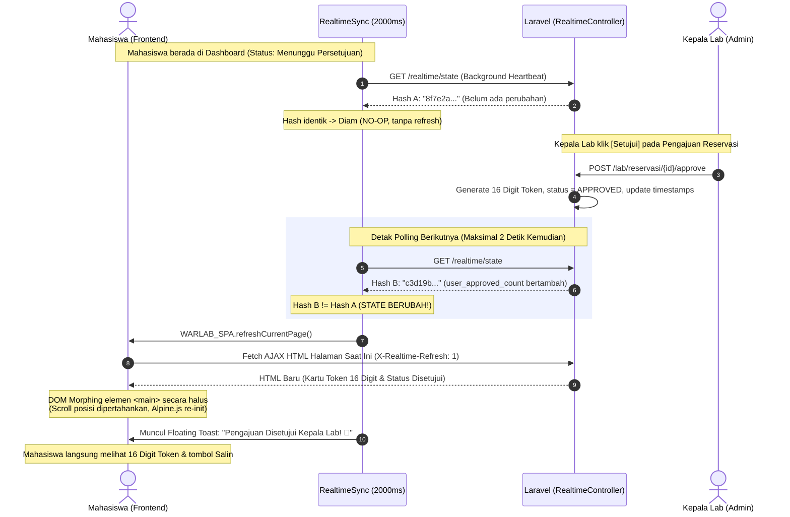

# Skema Arsitektur Frontend: State-Driven Realtime Update (Anti-Reload 3 Menit)

Dokumen ini menjelaskan rancangan dan cara kerja antarmuka (*frontend*) aplikasi **WARLAB** saat Kepala Lab melakukan perubahan terhadap pengajuan reservasi mahasiswa (Persetujuan / Penolakan / Pemutusan Sesi).

---

## 1. Perbandingan: Mengapa Refresh Berkala 3 Menit Ditinggalkan?

| Aspek | Model Tradisional (Refresh Tiap 3 Menit) | Model WARLAB (State-Driven Differential Polling) |
| :--- | :--- | :--- |
| **Pemicu Update** | Timer statis `setInterval(180000)` atau `<meta refresh>` | **State Server Berubah** (Event/Data-driven) |
| **Dampak di Layar** | Layar berkedip putih (*flash of white*), scroll melompat ke atas | **Mulus (*Zero Flash*)**, scroll dipertahankan (*in-place morph*) |
| **Kecepatan Update** | Terlambat (bisa menunggu hingga **180 detik**) | **Instan ($\le 2$ detik)** begitu Kepala Lab klik tombol |
| **Beban Jaringan** | Mengunduh ulang seluruh file HTML, CSS, JS, dan Gambar | Hanya mengunduh hash JSON **~150 bytes** saat diam |
| **Kenyamanan Input** | Formulir yang sedang diketik bisa ter-reset dan hilang | Ada proteksi deteksi elemen aktif (tidak mengganggu form) |

---

## 2. Diagram Alur State-Driven (Sequence Diagram)

Berikut alur interaksi antara **Mahasiswa**, **Background Engine Realtime**, **Server Laravel**, dan **Kepala Lab**:

---

## 3. Komponen Utama Skema Frontend

### A. Background Heartbeat (`resources/js/realtime.js`)
- Menggunakan objek singleton `RealtimeSync` yang diinisialisasi saat web dibuka.
- Menjalankan interval ringan setiap **2000 ms** (2 detik) memanggil endpoint `/realtime/state`.
- Menyimpan sidik jari status terkini (`currentHash`), `lastUserApprovedCount`, dan `lastUserSessionCount`.
- **Tidak ada manipulasi DOM** jika data server belum berubah.

### B. Differential Fingerprint Generator (`app/Http/Controllers/RealtimeController.php`)
Server menghasilkan hash MD5 dinamis dari stempel waktu perubahan entitas database:
$$\text{StateHash} = \text{MD5}(T_{\text{res}} + T_{\text{sess}} + T_{\text{comp}} + T_{\text{code}} + C_{\text{pending}} + C_{\text{active}} + U_{\text{id}} + U_{\text{sess}} + U_{\text{appr}})$$
- Begitu Kepala Lab menekan tombol **Setujui** atau **Tolak**:
  - Nilai stempel waktu `updated_at` pada tabel `reservations` berubah.
  - Tabel `access_codes` terisi token baru 16-digit.
  - Variabel $U_{\text{appr}}$ untuk mahasiswa yang bersangkutan berubah.
  - Hasil hash $\text{StateHash}$ otomatis berganti secara instan.

### C. In-Place DOM Morphing (`resources/js/spa.js`)
Ketika deteksi perubahan state terjadi (`currentHash !== newHash`):
1. **Pengecekan Aman (Guard Clause)**:
   - Jika mahasiswa sedang aktif mengetik di `<input>`, `<textarea>`, atau sedang membuka modal dialog, pembaruan DOM ditunda sementara agar ketikan tidak hilang.
2. **AJAX Background Fetch**:
   - Meminta HTML halaman aktif dengan header `X-Requested-With: XMLHttpRequest` dan `X-Realtime-Refresh: 1`.
3. **Penyisipan Halus (<main> Content Swap)**:
   - Pohon Alpine lama dibersihkan (`Alpine.destroyTree`).
   - Konten baru dimasukkan ke elemen `<main>`.
   - Pohon Alpine baru diaktifkan (`Alpine.initTree`).
   - Scrollbar jendela tetap di posisi koordinat $(X, Y)$ semula.
4. **Trigger Interaktif**:
   - Memancarkan Custom Event `warlab:short-poll-changed` ke jendela peramban.
   - Menampilkan banner toast persetujuan interaktif.

---

## 4. Skenario Transisi Tampilan Mahasiswa

### Skenario 1: Kepala Lab Menyetujui Reservasi (Approve)
1. **Sebelumnya**: Kotak kuning peringatan *"Pengajuan Reservasi Anda Sedang Ditinjau Kepala Lab"* dan baris tabel berstatus kuning `Menunggu Persetujuan`.
2. **Saat Disetujui**:
   - Kotak kuning berganti menjadi **Banner Hijau "Reservasi Disetujui"**.
   - Muncul kotak khusus **16 Digit Token Masuk PC** (contoh: `A7B2-9K4L-M1N8-X5P3`) lengkap dengan tombol **"Salin"**.
   - Petunjuk login: *"Ketikkan langsung pada layar monitor PC di lab"*.
   - Muncul notifikasi toast hijau di pojok kanan atas: *"Pengajuan Disetujui Kepala Lab! 🎉"*.
   - Baris tabel otomatis berubah status menjadi badge hijau `Disetujui`.

### Skenario 2: Kepala Lab Menolak Reservasi (Reject)
1. **Sebelumnya**: Pengajuan berstatus `Menunggu Persetujuan`.
2. **Saat Ditolak**:
   - Kotak kuning hilang seketika.
   - Baris tabel berubah menjadi badge merah `Ditolak` disertai alasan penolakan yang diketik oleh Kepala Lab.
   - Tidak ada gangguan layar berkedip.

### Skenario 3: Mahasiswa Menginput Token di Layar PC Lab (Check-in Fisik)
1. Mahasiswa mengetik 16-digit token di aplikasi Desktop Agent C# di PC workstation lab.
2. Desktop Agent memvalidasi ke `/api/desktop/check-in` $\rightarrow$ Sesi menjadi `ACTIVE`.
3. Server memperbarui `attendance_sessions` $\rightarrow$ State Hash berubah.
4. Dalam 2 detik, dashboard web mahasiswa berganti ke mode **Billing Sesi Aktif**:
   - Timer durasi berjalan (`00:00:00` bertambah tiap detik).
   - Sisa waktu peminjaman berkurang.
   - Tombol *"Akhiri Sesi Sekarang"* siap digunakan.

---

## 5. Ringkasan Keunggulan Skema Ini

- ✅ **Responsif**: Pembaruan terjadi dalam $\le 2$ detik, bukan 3 menit (180 detik).
- ✅ **Anti-Flicker**: Layar tidak berkedip putih seperti reload konvensional.
- ✅ **Hemat Bandwidth**: Hanya bertukar data puluhan byte jika tidak ada perubahan.
- ✅ **Aman**: Tidak merusak input data yang sedang diisi oleh mahasiswa.

